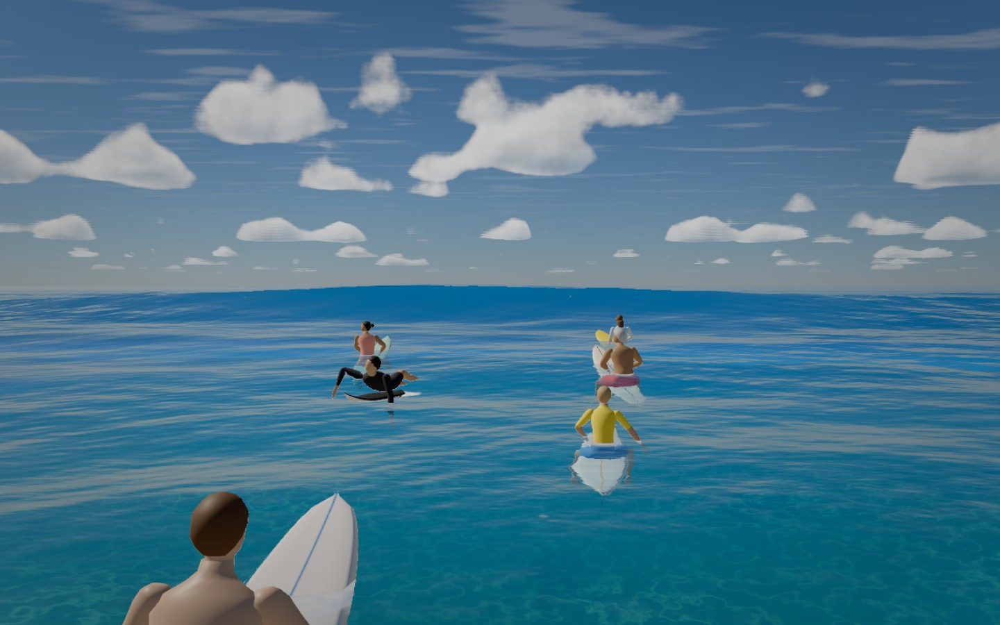
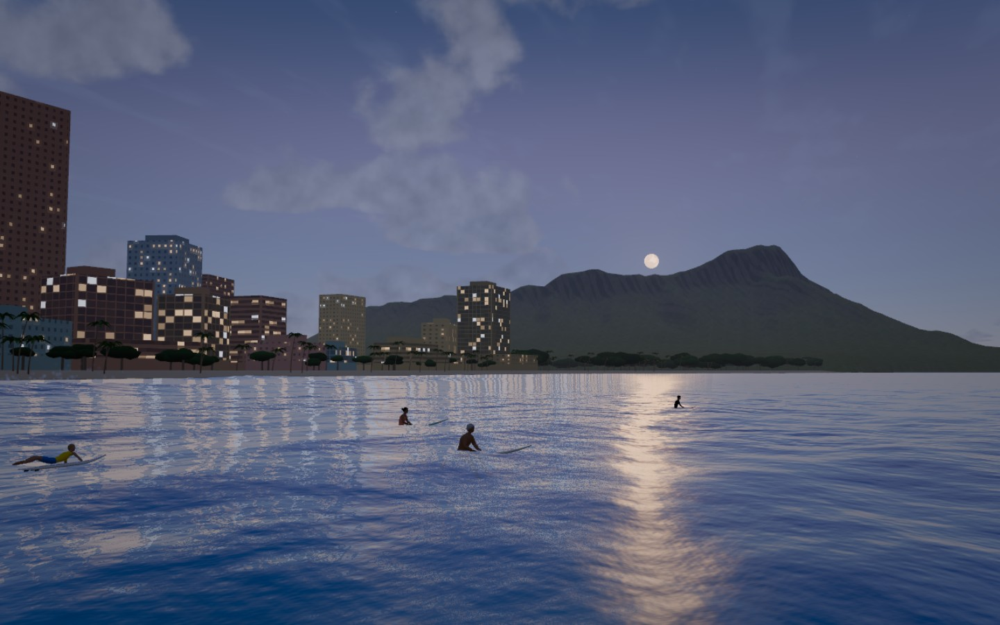

# Waikīkī Lineup

A multiplayer surf game set at Waikīkī that runs in the browser. Paddle out, read the sets, catch a wave, share the lineup. The sky follows real Hawaiʻi time, so it is night there when it is night there.

Play it at https://surf.actionsmatter.com. Version 1.0.


| | |
|---|---|
|  |  |
|  |  |

More in [`screenshots/1.0`](screenshots/1.0).

The client is TypeScript and Three.js (WebGPU, with a WebGL2 fallback). The server is a Cloudflare Worker with two Durable Objects: a room that runs the simulation, and a lobby that hands out rooms.

## Run it

```
npm install
npm run build     # the Worker serves the built client from dist/
npm run worker    # server on :8787
npm run dev       # client with hot reload on :5173, proxying /api to the server
```

Open http://localhost:5173. Add `?offline` to play with no server.

## Controls

| Action | Keyboard | Gamepad | Touch |
|---|---|---|---|
| Paddle | hold W | right trigger | hold the right side |
| Steer | A / D | left stick | left thumb stick |
| Pop up | Space when the wave lifts you | A | swipe up |
| Duck dive or turtle roll | X | X | swipe down |
| Sit up / lie down | S | B | board button |
| Kick out | E | Y | chevron button |
| Emotes | hold Q | D-pad up | |
| Roster | hold Tab | Select | |

Escape, or the Menu button, opens settings, where keys can be remapped. The full guide, with tips, is at `/how-to-play.html` ([live](https://surf.actionsmatter.com/how-to-play)).

## Test

- `npm test` runs the unit tests. `npm run typecheck` checks client and Worker.
- `tests/run.sh tests/net/clients.mts load|chaos`, `reconnect.mts` and `cap.mts` drive headless clients against a running server.
- `node tests/frames/flicker.mjs` plays in a real GPU browser and fails on black or blown-out frames.
- `node tests/frames/screenshots.mjs <version>` captures the release screenshot set into `screenshots/<version>/`.

## Deploy

`npm run build && npx wrangler deploy`, with your own Cloudflare account. Change or remove the `routes` entry in `wrangler.jsonc` first: it names the domain this copy is served from.

`rooms.maxRooms` in `shared/tuning.ts` caps how many rooms can be open at once, which caps what the server can cost. Every gameplay number lives in that file.

## Assets

Everything is generated in code except two elevation files from the USGS, which are public domain. See `ASSETS.md`. `ART.md` is the art direction.

## License

MIT. See `LICENSE`.
